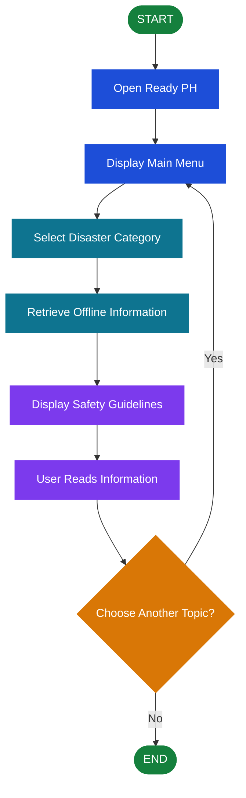

# Ready-PH
Disaster Offline Application

# 🇵🇭 Ready PH — Disaster Offline Application

  
  

  <strong>Be Prepared. Stay Safe. Save Lives.</strong>

## 📌 About the Project

**Ready PH** is a disaster preparedness application designed to help users access essential disaster-related information and safety guidelines even without an internet connection.

The application aims to promote disaster awareness and preparedness by providing accessible information about natural disasters such as earthquakes, typhoons, floods, and other emergencies.

With its offline functionality, Ready PH helps users review available safety information when internet connectivity is unavailable.

## 🎯 Objectives

- Provide accessible disaster preparedness information.
- Help users learn appropriate safety measures before, during, and after disasters.
- Make essential information available offline.
- Promote disaster awareness and community preparedness.
- Support users in learning how to respond to emergency situations.

## ✨ Key Features

- 📱 **User-Friendly Interface** — Simple navigation for accessing information.
- 📴 **Offline Accessibility** — Access locally stored information without an internet connection.
- 🌪️ **Disaster Information** — Information about supported disaster types.
- 🛡️ **Safety Guidelines** — Preparedness and response instructions.
- 📚 **Disaster Awareness** — Educational information to help users prepare for emergencies.

*Note: Keep only the features that are actually implemented in your application.*

## ⚙️ Application Workflow

1. **Launch Application** — The user opens Ready PH.
2. **Display Main Menu** — The application displays its available sections.
3. **Select Disaster Category** — The user selects a disaster topic.
4. **Retrieve Offline Content** — The application accesses the relevant locally stored information.
5. **Display Safety Guidelines** — The user reads the available instructions.
6. **Review Information** — The user learns about disaster preparedness and appropriate safety actions.

## 🔄 System Flowchart

## 💻 Programming Languages & Technologies

Add the logos of the **actual programming languages and tools used** to develop Ready PH.

<!-- Replace the example badges below with your actual technologies. -->

  <!-- Example: HTML -->
  
  <!-- Example: CSS -->
  
  <!-- Example: JavaScript -->
  

  <em>Example logos only — replace them if your application uses different technologies.</em>

### Technology Description

| Technology | Purpose |
|---|---|
| Programming Language | Implements the application's logic and functionality. |
| User Interface | Creates the screens, menus, and interactive elements. |
| Local Storage / Database | Stores information needed for offline access. |
| Development Environment | Used to write, test, and build the application. |

## 🧭 Importance of the Project

Ready PH aims to make disaster preparedness information more accessible, especially in situations where internet connectivity is limited or unavailable. By providing offline access to stored safety guidelines, the application can help users become more informed and better prepared for emergencies.

**Important:** Ready PH is an informational preparedness tool and should not replace official emergency alerts, evacuation orders, or instructions from local authorities.

## 👨‍💻 Project Information

- **Project Name:** Ready PH — Disaster Offline Application
- **Project Category:** Disaster Preparedness / Mobile Application
- **Primary Purpose:** Offline disaster awareness and safety information
- **Developer:** [Your Name]
- **Development Year:** [Your Project Year]

## 🚀 Future Improvements

- Add more disaster preparedness topics.
- Improve the interface and navigation.
- Expand the offline information library.
- Include verified emergency contact information.
- Add accessible language options.
- Regularly review safety information against official guidance.

---

  <strong>READY PH 🇵🇭</strong> 
  <em>Preparedness starts with awareness.</em>

